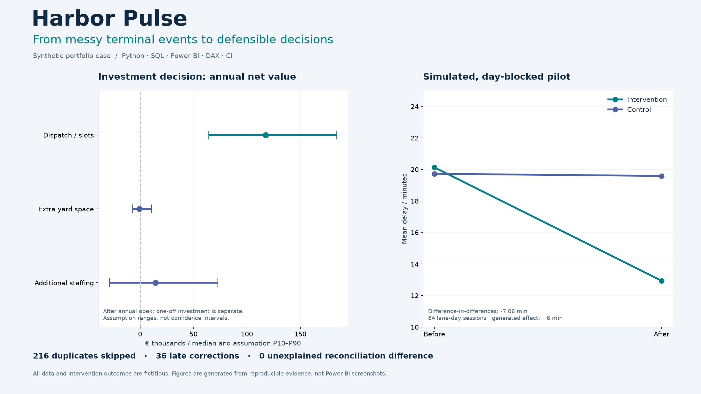
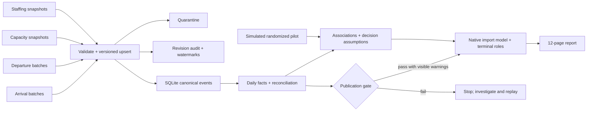

# Harbor Pulse

<!-- case-claim: {"case_version":"HP-2026.2","synthetic":true,"metrics":{"vehicles":366910,"fact_rows":1095,"late_corrections":36,"duplicates":216,"source_fact_difference":0,"report_pages":12,"report_elements":132,"model_tables":13,"measures":56},"recommendation":"Pilot dispatch first under invented assumptions; do not claim realized savings.","rls_viewer_status":"license-blocked"} -->

Case release **HP-2026.2** · 13 model tables · 56 measures · 12 pages · 132 report elements.

**From messy terminal events to defensible decisions.** A reproducible analytics case for a fictional terminal network in Zeebrugge, Antwerpen and Gent.

[](https://github.com/phlppgdfry/harbor-pulse/actions/workflows/verify.yml)



**Business question:** how could a terminal operator reduce delay without merely moving queues, overstating savings or losing trust in its numbers?

This case follows the whole path: source contracts → audited ingestion → a governed star model → Power BI → an investment comparison → a pilot design. All organizations, records, costs and outcomes are fictitious. The cover is an evidence figure generated from the code, not a Power BI screenshot. Developed with AI assistance; the repository exposes the logic, assumptions and checks for review.

## Nederlandstalig leren en voorbereiden

[**Kennisgids**](docs/KENNISGIDS-NL.md): termen, processen en handberekening · [**Interviewbank**](docs/INTERVIEWBANK-NL.md): 12 HR-vragen en 30 seniorvragen met antwoordrichtingen · [**Zelfstandige demonstratie**](docs/DEMONSTRATIE-NL.md): vier lokale opdrachten met een uitvoerbare verificatiehelper. Een helperrun is geen bewijs dat de portfolio-eigenaar de oefening zelfstandig heeft uitgevoerd.

## Review in 30 seconds

**Problem:** reduce terminal delay without hiding bad data or overstating cash savings.
**Approach:** audited Python/SQLite ingestion → weighted Power BI KPIs → investment sensitivity → a simulated pilot.
**Recommendation:** pilot dispatch/appointment slots first under the invented assumptions; require real operational and finance evidence before investment.
**Portfolio owner:** Philippe Godfroy; developed with substantial AI assistance. [Contribution, choices and interview guide](docs/OWNERSHIP.md).

| Your route | Start here |
|---|---|
| Recruiter / hiring manager | [Public walkthrough — no login](https://phlppgdfry.github.io/harbor-pulse/) · [Two-minute video](docs/assets/harbor-pulse-walkthrough.mp4) · [One-page PDF](output/pdf/harbor-pulse-recruiter-brief.pdf) |
| Data analyst reviewer | [Five-minute tour](docs/RECRUITER-TOUR.md) · [SQL examples](sql/reviewer_queries.sql) · [Selected DAX](docs/DAX-EXAMPLES.md) |
| Analytics / BI engineer | [Pipeline and tests](docs/PIPELINE.md) · [Operating evidence](docs/OPERATIONS.md) · [Implementation status](docs/CONTROL-STATUS.md) |
| Decision / experiment reviewer | [Management memo](docs/EXECUTIVE-BRIEF.md) · [Robustness checks](docs/ROBUSTNESS.md) · [Pilot pre-registration](docs/PILOT-PREREGISTRATION.md) |

The public walkthrough includes seven reproducible analysis figures and an interactive sensitivity comparison. It now also includes [genuine Power BI screenshots](docs/assets/powerbi/) of all twelve pages, captured through Microsoft’s SDK in an isolated headless CLI session. Pixel review found and fixed clipped text, inactive table measures, undersized slicers and misleading totals. [Render evidence](evidence/powerbi-render.json). The export-to-file API restrictions remain, but they no longer block screenshots or visual QA.

## Evidence you can inspect

| Control | Reproduced result | Evidence |
|---|---:|---|
| Duplicate transport events | 216 skipped without double counting | [Load logs](evidence/loads.json) |
| Bad/conflicting records | 4 quarantined; last valid version retained | [Gate](evidence/gate.json) |
| Snapshot replay | 0 inserts and 0 updates | [Load logs](evidence/loads.json) |
| Late revisions | 36 audited upserts | [Summary](evidence/summary.json) |
| Source → fact reconciliation | 0 unexplained vehicle difference | [Summary](evidence/summary.json) |
| Missing valid departures | 67 transport batches, exposed as incomplete coverage | [Load logs](evidence/loads.json) |
| Daily grain | 1,095 terminal-days; 366,910 vehicles after correction | [Summary](evidence/summary.json) |
| Investment comparison | Three options, 2,000 assumption draws each | [Decision evidence](evidence/decisions.json) |
| Pilot estimator | Balanced, randomized lane-days; paired-day bootstrap | [Pilot evidence](evidence/pilot.json) |

The publication gate requires zero reconciliation difference, at least 99% valid departure coverage and at most 0.1% rejected input rows. A passing gate can still carry visible warnings. The pipeline deliberately refuses a publication with insufficient coverage.

## The decision, with its limits

Under the chosen assumptions, **pilot dispatch/appointment slots first**. It has a stronger conservative annual net-value range than expanding yard space or adding staff. That is an assumption-based recommendation to test, not a claim of realized savings.

The comparison subtracts annual operating cost, shows one-off implementation cost separately, and values only the **usable fraction** of waiting-time reductions. P10/P90 describe draws from invented assumptions; they are not confidence intervals. Payback is conditional on positive annual net value and must be read together with the loss probability. [Full decision note](docs/DECISION.md)

## Architecture



The active Power BI model is now a [native import model with terminal roles and monitored refresh](docs/NATIVE-OPERATIONS.md). Its typed M partitions embed the governed synthetic source snapshot; this is not a live terminal-system connection. The previous push snapshot is retained in the archive.

The file adapter scans complete snapshots, but database changes are incremental: business key, version and hash determine whether a record is new, corrected, duplicated or conflicting. Watermarks are observable state, not a timestamp-only filter that silently drops backdated corrections. Materialized facts are rebuilt inside the same transaction. [Pipeline design](docs/PIPELINE.md)

## Power BI experience

The report has 12 pages, 132 report elements and 56 DAX measures across a daily star model and evidence tables:

1. Management — goals, trends and ranked improvement points.
2. Daily operations — weekday patterns and service/capacity targets.
3. Terminal detail — volume, planning and service indicators.
4. Disruption analysis — the invented maintenance episode.
5. Finance — revenue, budget, cost and gross margin.
6. Scenario lab — capacity, delay, waiting-hour value and usable fraction.
7. Data & method — definitions, scope and daily details.
8. Data quality — quarantine, coverage, reconciliation and load history.
9. Evidence — maintenance, volume, weekday, staffing and terminal associations.
10. Investment decision — costs, assumption ranges and uncertainty.
11. Pilot measurement — before/after intervention and control groups.
12. KPI & operations — role ownership, access design, monitoring and recovery.

[Existing report](https://app.powerbi.com/groups/me/reports/741c3f14-d0f1-4f98-8608-38ec8f4013d8) requires an authorized Microsoft account. The public case is independently reviewable and runnable without that account. Report source is in [the builder](scripts/build_report.py) and [operating-model pages](scripts/report_operating_model.py). No browser automation is needed for publication.

## Read the case like a reviewer

| Question | Artifact |
|---|---|
| What decision is this supposed to support? | [Case brief](docs/CASE.md) |
| What exactly does each KPI mean, and who owns it? | [KPI contracts](docs/KPI-CONTRACTS.md) |
| How do errors, duplicates and corrections behave? | [Pipeline](docs/PIPELINE.md), [executable tests](tests/test_pipeline.py) |
| Did we investigate alternative explanations? | [Analysis](docs/ANALYSIS.md), [coefficients](evidence/associations.json) |
| Are savings assumptions and implementation costs explicit? | [Decision note](docs/DECISION.md) |
| How would we establish an actual intervention effect? | [Pilot protocol](docs/PILOT.md) |
| Who can publish, how is refresh monitored, how do we recover? | [Operations runbook](docs/OPERATIONS.md) |
| Which production controls are actually implemented? | [Control status](docs/CONTROL-STATUS.md) |

## What this demonstrates

Problem framing, source contracts, SQL storage, idempotent ingestion, error quarantine, auditability, reconciliation, dimensional modeling, weighted DAX, scenario reasoning, experimental design, confidence versus assumption uncertainty, and a documented release/recovery process.

It does **not** claim a real operational deployment, actual cost savings, validated causal predictions or production access controls. Three native terminal roles are deployed and the explicit report/model access roster is audited. No extra users are granted access. Effective-role viewer rendering remains license-blocked. CI reproduces the synthetic case weekly; a daily local job performs native refresh and reconciliation, with an hourly 26-hour freshness monitor. [Implementation versus design](docs/CONTROL-STATUS.md)

## Reproduce the case

```bash
git clone https://github.com/phlppgdfry/harbor-pulse.git
cd harbor-pulse
uv sync --locked --extra report
uv run --locked python -m unittest discover -s tests -v
uv run --locked python -m harbor_pulse demo
uv run --locked python scripts/check_evidence.py
uv run --locked python -m harbor_pulse monitor
```

Python 3.12+; the core pipeline and analyses use the standard library. No cloud account, database server or secrets are needed to reproduce the case. The demo writes generated sources, a SQLite warehouse, load logs and results under ignored `build/`. For a second independent replay demonstration, choose a fresh output directory: `python -m harbor_pulse demo --output build/another-run`.

Additional reviewer evidence: `python scripts/review_evidence.py`.

Optional report generation: the `--extra report` environment above includes the locked dependencies. Run `uv run --locked python scripts/build_report.py` and `uv run --locked python scripts/validate_report.py`. `requirements-report.txt` remains a legacy pip compatibility option. [Power BI publication instructions](docs/POWER-BI.md) require your own authorized Microsoft account.

## Repository map

```text
harbor_pulse/  source generation, audited pipeline, analyses and CLI
scripts/      report builder, schemas, publication and verification
powerbi/      generated model and inspectable PBIR source; cloud binding removed
tests/        failure, correction, coverage and estimator checks
contracts/    source ownership and revision rules
evidence/     reproducible summaries; no private account receipts
docs/         case, KPI contracts, pilot, decisions and runbooks
templates/    reusable Power BI report resources
schemas/      Microsoft PBIR schemas and original license
build/        generated data, warehouse and private publication receipts (ignored)
```

Microsoft JSON schemas are included under their original license in `schemas/LICENSE`. Report geometry, cloud queries, definition read-back and actual pixel rendering are checked separately. [Native operations and remaining limits](docs/NATIVE-OPERATIONS.md).

## Development quality

Python dependencies are locked with uv; Ruff, branch coverage, Hypothesis, pre-commit, Gitleaks, SQLite SQLFluff and committed Playwright checks run locally and in CI. See [setup, commands and test boundaries](docs/DEVELOPMENT.md). Browser QA produces desktop/mobile screenshot artifacts without taking over a signed-in browser.

## Challenge this case

[Data fitness and hand calculations](docs/DATA-FITNESS.md) explain what batch data can establish and which vehicle-level questions it cannot answer. [Six assumption challenges](docs/ASSUMPTION-CHALLENGES.md) expose investment reversal thresholds, cost/time dependence, selective missingness, changing periods, priority weights and useful-versus-significant pilot outcomes. [Release and evidence controls](docs/RELEASE-CONTROLS.md) describe verified rollback, duplicate prevention, clean-checkout reproduction, accessibility and the remaining RLS viewer limit.
