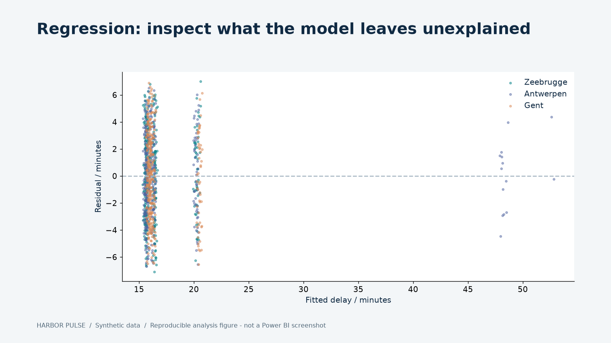
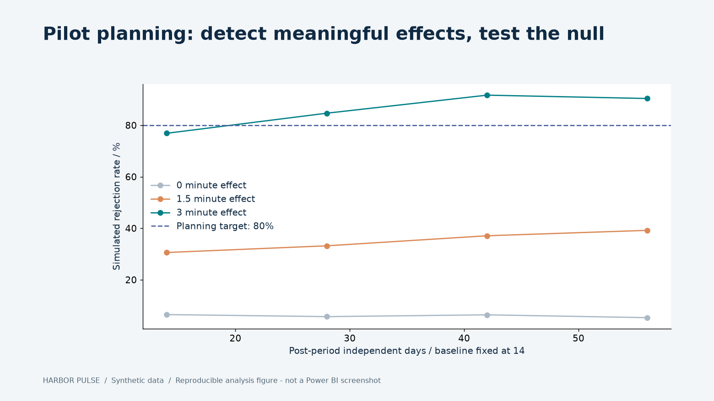

# Robustness and sensitivity review

All checks describe synthetic data. Reproduce with `python scripts/review_evidence.py` after running the demo.

## Investment sensitivity

The [32-cell raster](../evidence/sensitivity.json) varies realizable savings from 0% to 20% and waiting-hour value from EUR 25 to 60. For each option it shows annual net, first-year cash after implementation cost, and the realizable break-even fraction. If every option is negative, the recommendation is **do not implement**. Central time reductions are fixed; the original Monte Carlo separately varies them and cost-value assumptions.

The raster gives every option the same realizable fraction to expose the role of that input. The original comparison uses option-specific realization ranges, so the two should not be confused. Neither is a probabilistic forecast of real outcomes.

## Regression diagnostics

[Executable diagnostics](../evidence/diagnostics.json) include:

- A chronological Q4 holdout: RMSE 3.56 min versus 4.11 min for the training-mean baseline.
- Whole-week bootstrap coefficient intervals across terminal-days, retaining within-week temporal and terminal dependence.
- VIF checks: staff-hours intensity about 15.1 and Gent about 12.7 indicate meaningful multicollinearity.
- Within-terminal lag-one residual correlations of approximately .22, .09 and .17.
- Monthly residual means/RMSE and a residual-versus-fitted plot.

The holdout lacks the encoded maintenance episode, so it cannot validate the maintenance association. Modest improvement over a mean baseline is not production forecast validation. Weekly resampling is a diagnostic choice; dependencies beyond a week may require larger blocks. Strongly correlated regressors undermine an independent causal interpretation of staffing.

## Pilot planning and falsification

The [planning simulations](../evidence/pilot-planning.json) use an invented paired-difference SD of 3 min and 1,000 simulations per cell. Four post-period sizes and four effect sizes include a genuine zero-effect scenario. With 28 post days, the simulated rejection rates are about 5.7% under zero effect and 84.7% for a three-minute effect. This is power for rejecting zero, not for proving a minimum three-minute benefit. The normal critical value is approximate; its observed null rate is disclosed rather than assumed exactly 5%.

A separate no-treatment placebo contrast includes zero in its simulated 95% distribution. Random dropout and 25%/50% control spillover illustrate loss of information and attenuation. This does not establish robustness to nonrandom missing outcomes. See the locked [case protocol](PILOT-PREREGISTRATION.md) before interpreting the simulated -7.06 minute estimate.

